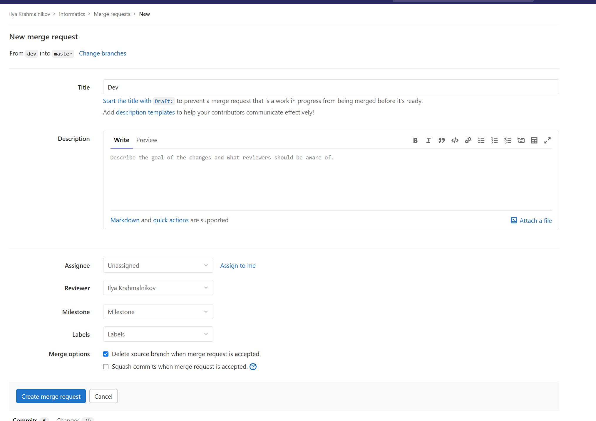
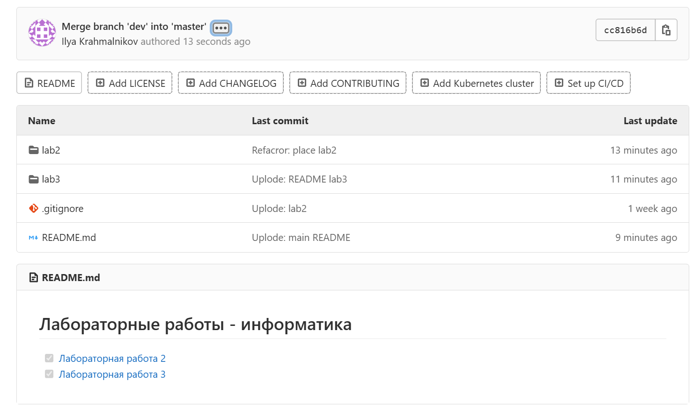
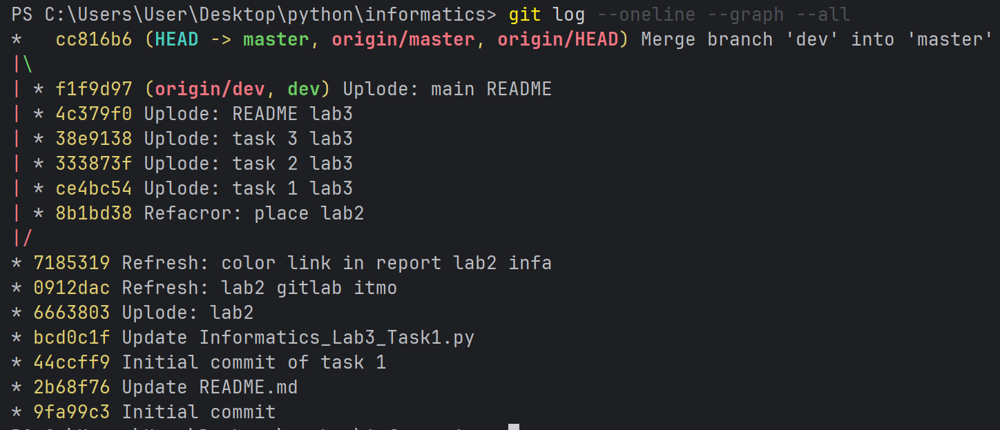

# Лабораторная работа №3

> Выполнил:
> Крахмальников Илья

## Задание 1

Вариант: 558473 % 7 = `6`

Регулярное выражение:
```python
reg = r"(?<=id=[\"'”])[^\"'”]+(?=[\"'”])"
```

## Задание 2

Вариант: 558473 % 5 = `3`

Замечание:

- Инициалы - это первые буквы фамилии, имени, отечества (я именно так рассматриваю данный термин)
- Фамилия может быть двойной (через -)
- Отчество может отсутствовать
- Имена и отчество могут писать, как сокращенно, так и полностью (точка не обязательна)
- Фамилия всегда полностью пишется

В остальных случаях запись считается некорректной и пропускается в ответ

Регулярное выражение:
```python
reg_full = (r"[^А-ЯЁа-яё]*"
                r"([А-ЯЁ][а-яё]*(?:-[А-ЯЁ][а-яё]+)?)"
                r"\s*"
                r"([А-ЯЁ][а-яё]*)\.?"
                r".*"
                r"([А-ЯЁ][а-яё]*)\.?"
                r"[^А-ЯЁа-яё]*")
reg_no_last_name = (r"[^А-ЯЁа-яё]*"
                    r"([А-ЯЁ][а-яё]*(?:-[А-ЯЁ][а-яё]+)?)"
                    r"\s*"
                    r"([А-ЯЁ][а-яё]*)\.?"
                    r"[^А-ЯЁа-яё]*")
```


## Задание 3

Вариант: 558473 % 3 = `2`

Регулярное выражение:
```python
reg_number = r".*[0-9].*"
reg_upper = r".*[A-Z].*"
reg_special = r".*[^\w\s].*"
reg_sum = r"[1-9]"
reg_month = (r"(?i).*(january|february|march|april|may|june|july"
             r"|august|september|october|november|december).*")
```

## Pull-request

1. Все решение 3 лабы происходило в ветке dev

2. Сделал pull-request в ветку master




*График веток*

