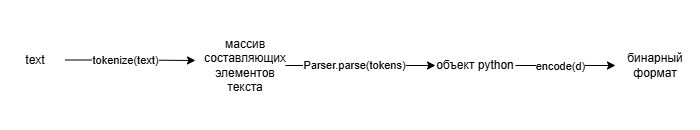
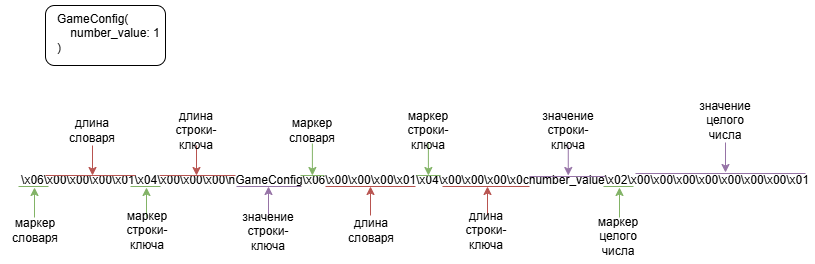
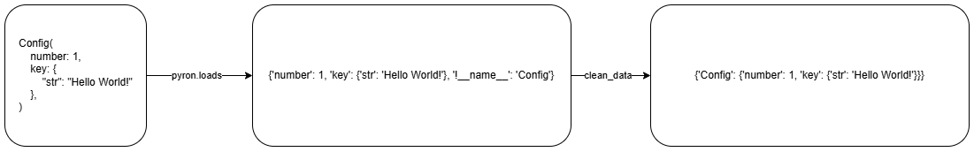

# Лаба 4

## Задание 1

- [Код по преобразованию .ron в бинарный формат](code/ml/ron.py)
- [Код 1 задания](code/task1.py)

### Логика преобразования из .ron в бинарный формат (десериализация)


### Пример простого RON -> bytes


## Задание 2

- [Код по преобразованию из бинарный формат в yaml](code/ml/yaml.py)
- [Код 2 задания](code/task2.py)

### Логика преобразования из бинарного формата в .yaml (сериализация)


## Задание 3

- [Код 3 задания](code/task3.py)

### Обработка ron в объект python с помощью библиотеки pyron


## Задание 4

- [Код по преобразованию объекта_python в xml](code/ml/xml.py)
- [Код 4 задания](code/task4.py)

## Задание 5

- [Код 5_задания](code/task5.py)

## Запуск

```bash
python -m venv .venv
```

```bash
.venv/scripts/activate 
```

```bash
pip install -r requirements.txt
```

```bash
cd code
python task1.py
python task2.py
python task3.py
python task4.py
python task5.py
```

также можно передавать в качестве аргументов название файлов для парсинг
```bash
cd code
python task1.py schedule
```

в 5 задании можно также передать число интерация для парсинга
```bash
cd code
python task5.py schedule 100
```