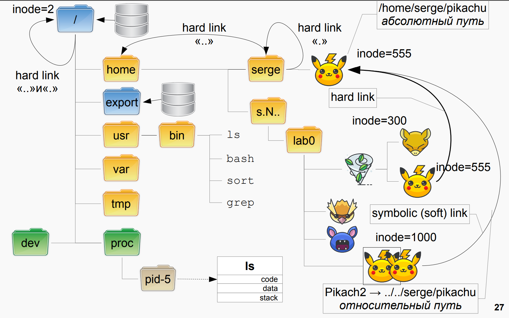

# Лаба 1

## Unix

UNIX - это семейство переносимых, многозадачных и многопользовательских операционных систем, основанных на идеях оригинального проекта

- это проприетарная (закрытая) система с закрытым исходным кодом, которая исторически использовалась в основном на серверах

## Linux

Linux — это семейство свободных, открытых операционных систем, основанных на ядре Linux. Его создал Линус Торвальдс в 1991 году как бесплатную альтернативу другим системам

Linux не является версией или наследником UNIX в строгом смысле: его разработчики сознательно создали систему, вдохновлённую философией UNIX, но с нуля написали собственную кодовую базу

## Posix

POSIX - это набор стандартов, который описывает, каким должен быть интерфейс операционной системы.

Главная цель POSIX — обеспечить переносимость программного кода. Если программа написана с использованием только тех функций и вызовов, которые определены в POSIX, её исходный код можно скомпилировать и запустить на любой другой POSIX-совместимой системе с минимальными изменениями или вообще без них

## Интерпретатор

Интерпретатор — это программа, которая читает ваш код и сразу его выполняет, строчка за строчкой

## Компилятор

Компилятор — это программа, которая переводит исходный код в машинный код целиком, до того как программа будет запущена

## Консоль && терминал && оболочка

Терминал — это устройство (или программа) для ввода и вывода текста. 

Консоль — это физическая панель управления или главный системный терминал. 

Shell (оболочка) — это та самая программа-интерпретатор, которая работает внутри них

Bash — это конкретная программа, которая является одним из самых популярных Shell'ов в мире

### Порядок работы

1. Вы открываете Терминал

2. Внутри этого терминала автоматически запускается Оболочка (Shell), например bash — тот самый интерпретатор

3. Вы пишете команду: ls -l и нажимаете Enter

4. Терминал передает эту текстовую строку оболочке. (Терминал не понимает, что такое ls, он просто передает текст)

5. Оболочка (интерпретатор) читает строку, понимает, что это команда, и делает системный вызов к Ядру (просит его вывести список файлов)

6. Ядро выполняет работу

7. Результат (список файлов) отправляется обратно через оболочку в терминал

8. Терминал отображает этот текст на вашем экране

## История Linux && Unix

Лицензия BSD — это одна из самых свободных открытых лицензий

### Unix
1969: Первая версия Unix, написанная на ассемблере

1971: Выпуск Unix V1 и первого руководства по системе

1973: Поворотный момент — Unix переписывается на только что созданный язык C. Это делает систему переносимой на другие компьютеры, что и обеспечило ей будущее

1974: Публикация статьи о Unix в журнале ACM, после чего систему начали активно распространять в университетах

1975: Выпуск Unix V6, который стал широко доступной «исследовательской» версией

1979: Выпуск Unix V7, который считается последней «настоящей» Unix от Bell Labs и прямым предком большинства современных коммерческих Unix-систем

### Linux
В 1991 году финский студент Линус Торвальдс начал работу над ядром в качестве хобби-проекта. Он был вдохновлен системой Minix (учебной Unix-подобной ОС) и стремился создать что-то совместимое с POSIX. 25 августа 1991 года он публично объявил о своем проекте в новостной группе

## Файловая система

В мире *NIX действует главное правило: «Всё есть файл». Диски, папки, процессы, устройства - для ядра всё это выглядит как файлы



### Корень / (inode=2)

Это самая вершина (синяя папка). Отсюда растет всё остальное

### Стандартные папки

/home — здесь лежат папки пользователей (например, serge)

/usr/bin — здесь лежат исполняемые файлы программ (те самые ls, bash, sort, grep, которые мы обсуждали)

/var, /tmp — для временных файлов и изменяемых данных

/dev (зеленая папка) — здесь лежат файлы устройств (диски, мыши)

/proc (зеленая папка) — виртуальная файловая система (об этом ниже)

/export — обратите внимание на иконку диска. Это точка монтирования. Сюда подключен отдельный физический диск или раздел

### Имена файлов

не могут в себе содержать символ "/", а также спецсимвол обрезки "\0"

### Права доступа
Три типа прав: r (чтение), w (запись), x (выполнение).

Три категории пользователей: u (владелец), g (группа), o (остальные).

Команды: chmod (смена прав, например chmod +x file или chmod 755 file), chown (смена владельца)

#### SUID && SGlD

Задать сразу SUID && SGlD
```
chmod a+s file1
```

Задать сразу SUID
```
chmod u+s file1
```

Задать сразу SGlD
```
chmod g+s file1
```

```
chmod 6777 file1

-rwsrwsrwx     2 s558473 studs   12  8 окт.  17:57 file1
```

```
chmod 6000 file1

---S--S---     2 s558473 studs   12  8 окт.  17:57 file1
```

Если права на исполнения есть - s; Если права нет - то S (выше пример)

#### Stiсky-бит

Если на папке установлен Sticky bit. Теперь удалить файл из этой папки может только тот, кто его создал (владелец файла), либо владелец самой папки, либо суперпользователь root

```
ls -ld /tmp
drwxrwxrwt 10 root root 4096 Oct 24 10:00 /tmp
```

Если запрещено исполнение для других
```
drwxr-x--T     5 s558473 studs    8  8 окт.  17:15 lab0
```

### Inode

Inode (индексный дескриптор) — это невидимая для пользователя структура данных на диске, которая хранит всю информацию о файле, кроме его имени. В inode записано: кто владелец файла, какие у него права доступа, какого он размера, и где именно на жестком диске лежат его данные

Inode совпадают:
- у жестких ссылок (указывают на один адрес памяти)
- в разных файловых системах могут совпадать inode

### Жесткие ссылки

ln <файл> <название жесткой ссылки>
```bash
ln file1 link 
```

Жесткие ссылки нельзя делать на папки (чтобы не было циклов) и нельзя делать между разными дисками (так как inode уникален только внутри одного раздела)

### Символические ссылки

Симлинк — это отдельный файл со своим собственным inode, внутри которого просто записан текстовый путь к другому файлу. Если вы удалите оригинал, симлинк останется, но будет «битым» (не будет работать)

## Дескрипторы

Файловый дескриптор - это просто число (целое), которое ядро выдает процессу, когда тот открывает файл (или сокет, или устройство), чтобы процесс мог потом работать с этим файлом, не зная его реальных адресов на диске

Зарезервированные:

- 0 - stdin
- 1 - stdout
- 2 - stderr

## Escape-последовательность

Это комбинация символов, которая говорит программе (или терминалу): «Не воспринимай следующие за мной символы буквально. Я даю тебе особую команду»

- \t - табуляция
- \n - перевод строки
- \b - удаления
- \r - возврат консоли

Еще из интересных:
- \e[m34 - смена цвета

## Команды
### ls

